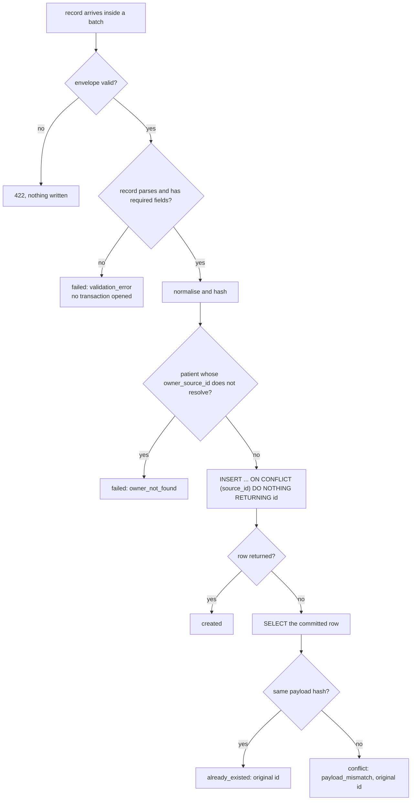
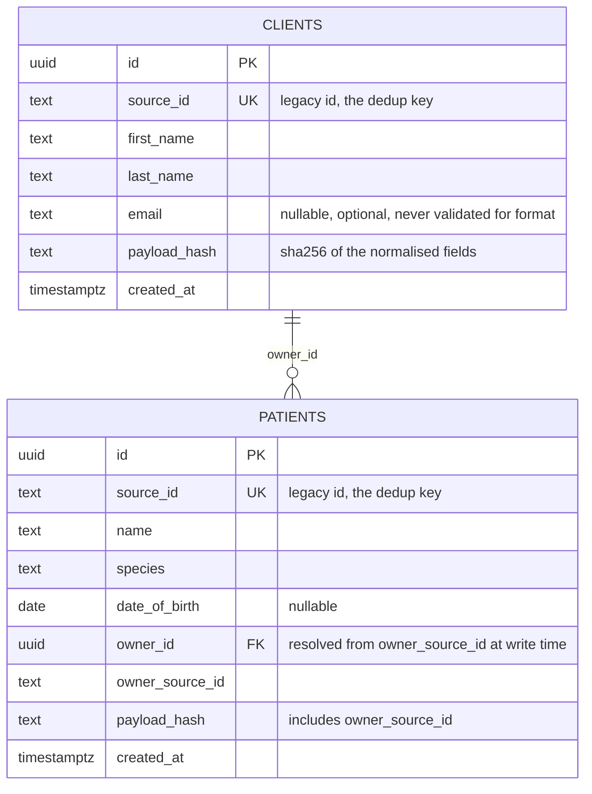
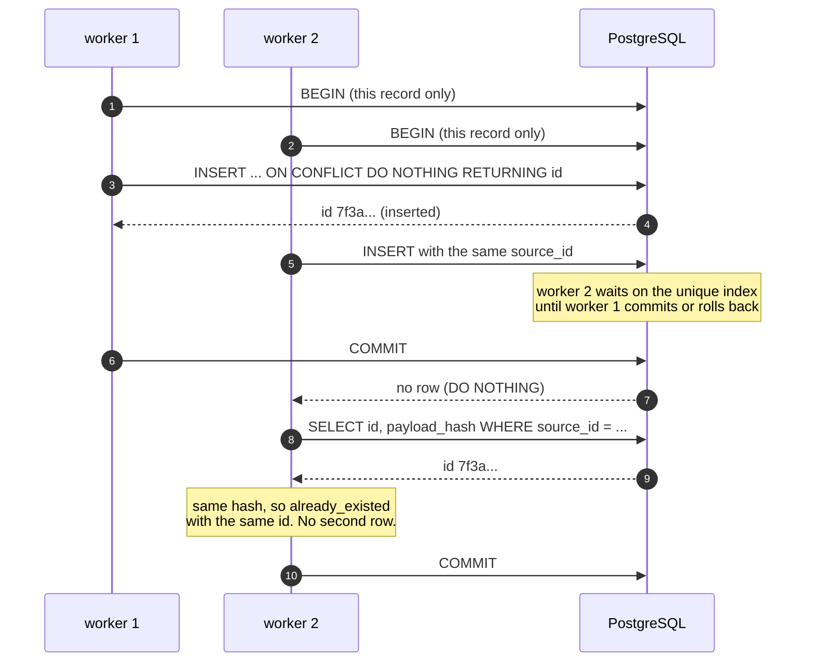

# Idempotent bulk import

A small HTTP service that receives clinic data in batches from a migration tool: clients (pet
owners) and patients (their animals). It is **always safe to retry** — sending the same records
again, one after another or from ten workers at the same time, never creates a duplicate and
always answers with the same ids.

Python 3.12, FastAPI, psycopg 3 with raw SQL, PostgreSQL 16, pytest. Everything runs in Docker;
the only prerequisite is **Docker with the Compose plugin**.

The design is deliberately short: one transaction per record, the idempotency guarantee in a
database constraint, and every decision written down with the alternative it rejected. It is
meant to be read in one sitting and defended line by line.

## What was asked, and where it is

| Requirement | Where it lives |
|---|---|
| One request carries many records; the answer says per record whether it was created, already existed or failed, and why | [API](#api), [Verify 1-2](#verify-it-by-hand) |
| A patient points at its owner; a missing owner fails that record only | [Verify 5](#verify-it-by-hand) |
| Retrying is always safe, sequentially or concurrently, with the same ids | [ADR 0001](docs/adr/0001-dedup-on-source-id.md), [`tests/concurrency/`](tests/concurrency) |
| A record resent with different data: decide and justify | [ADR 0002](docs/adr/0002-conflict-policy.md), [Verify 3-4](#verify-it-by-hand) |
| Tests that prove it, including concurrent duplicates | [Tests, and what each proves](#tests-and-what-each-proves) |
| The notification that happens after the write commits (written answer, no code) | [`docs/written-answer.md`](docs/written-answer.md) |
| One command to start it, one to run the tests | [Run](#run), [Test](#test) |
| How AI was used and what had to be corrected | [`docs/ai-usage.md`](docs/ai-usage.md) |
| What I would do next, and what I cut | [What I would do next](#what-i-would-do-next-and-what-i-cut) |
| Owners arriving late, throttling, multi-day progress reporting (one line each, not built) | [Not built, deliberately](#not-built-deliberately) |

## Run

```bash
docker compose up --build
```

```bash
curl localhost:8000/health
# {"status":"ok"}
```

The service is on <http://localhost:8000>, with interactive docs at
<http://localhost:8000/docs>. The schema is applied at startup (`CREATE TABLE IF NOT EXISTS`).

## Test

```bash
docker compose run --rm tests
```

30 tests, about two seconds. To run one file or one test:

```bash
docker compose run --rm tests pytest tests/api -q          # the HTTP contract
docker compose run --rm tests pytest tests/concurrency -q  # the races
docker compose run --rm tests pytest -k conflict -q        # by name
```

The tests use a **separate database** on the same server (`bulk_import_test`), created by the
test session and truncated between tests, so `docker compose up` data is never touched.

The concurrency tests start a real uvicorn server on a free port and fire requests from real
threads over sockets. `TestClient` calls the app in-process, so it cannot show two writers
racing on the same rows: the race is in PostgreSQL, and the point of the test is that only a
`UNIQUE` constraint closes it. The duplicate test repeats five rounds, because a race that did
not happen once proves nothing.

## Configuration

Nothing to configure for the documented commands: `compose.yaml` sets the two variables.

| Variable | Used by | Value in Compose |
|---|---|---|
| `DATABASE_URL` | the service | `postgresql://postgres:postgres@db:5432/bulk_import` |
| `TEST_DATABASE_URL` | pytest | `postgresql://postgres:postgres@db:5432/bulk_import_test` |

The database port is deliberately **not** published, so `docker compose up` cannot fail because
something else on the machine already holds 5432. [Look at the data](#look-at-the-data) shows how
to query it anyway.

## Repository map

```
src/bulk_import/
  main.py           routes, the connection pool, the response shape (thin on purpose)
  schemas.py        Pydantic: the envelope is validated whole, records one by one
  normalize.py      the single place where "same data" is defined, plus the payload hash
  import_service.py the use case: one short transaction per record
  db.py             pool sizing, schema loading, no ORM
  schema.sql        clients, patients, and the UNIQUE constraints everything rests on
examples/           the requests used in this README, as files a test also posts
scripts/
  demo.sh           a scripted migration: five requests and the report for each
  report.py         prints one response as a report; standard library only
tests/
  unit/             normalisation and hashing, no database
  api/              the HTTP contract: statuses, conflicts, 422 vs failed
  concurrency/      real server, real threads, plus the negative control
  conftest.py       test database, per-test cleanup, the live server fixture
docs/
  adr/              the three decisions that carry the design, one page each
  written-answer.md the post-commit notification question
  ai-usage.md       how AI was used and what it got wrong
compose.yaml        db (healthcheck) + app + a `tests` service behind a profile
Dockerfile          one image for the service and the tests, Python 3.12 slim
pyproject.toml      ruff and pytest configuration
```

## One record, end to end



One short transaction per record, so `created`, `already_existed`, `conflict` and `failed` are
decided independently for every row in the batch.

## Schema



`UK` on `source_id` in both tables is the whole idempotency guarantee; `payload_hash` is what
separates an identical retry from a changed record.

## API

Two endpoints with the same behaviour: `POST /clients/bulk` and `POST /patients/bulk` take up
to 1000 records, answer `200` with one result per record **in request order**, and never fail
the batch because of one bad record. Ids are UUIDs generated by the database.

```json
{"records": [{"source_id": "C-1", "first_name": "Ana", "last_name": "Ruiz", "email": "ana@example.com"}]}
{"records": [{"source_id": "P-1", "name": "Luna", "species": "dog",
              "date_of_birth": "2020-01-02", "owner_source_id": "C-1"}]}
```

| `status` | `id` | `error.code` | Meaning |
|---|---|---|---|
| `created` | new uuid | `null` | written by this request |
| `already_existed` | original uuid | `null` | same data, nothing written |
| `conflict` | original uuid | `payload_mismatch` | same `source_id`, different data, nothing overwritten |
| `failed` | `null` | `validation_error`, `owner_not_found` | rejected, nothing written |

Validation is minimal and deliberate: required fields present and non-empty after normalisation,
bounded length, `date_of_birth` parseable as `YYYY-MM-DD`, `owner_source_id` resolvable. Email
format is **not** validated — the field is optional, and failing a real client over an address
this service cannot verify would block a migration for no gain.

`422` is reserved for a malformed **envelope**: `records` missing, not a list, empty, or longer
than 1000. A bad field inside a record is a per-record `failed`, so one broken row never rejects
the other 999.

## Verify it by hand

Seven requests, in order, against a fresh `docker compose up`. Each one ends with the part of
the answer that matters; ids are random per run. The same requests are also files in
[`examples/`](examples), and [the section after this one](#examples-and-a-scripted-run) runs them
for you.

**1. Create two clients.** One request, many records, one result each:

```bash
curl -s -X POST localhost:8000/clients/bulk -H 'content-type: application/json' -d '{
  "records": [
    {"source_id": "C-1", "first_name": "Ana", "last_name": "Ruiz", "email": "ana@example.com"},
    {"source_id": "C-2", "first_name": "Luis", "last_name": "Paz"}
  ]
}'
```

```json
{
  "summary": {"created": 2, "already_existed": 0, "conflict": 0, "failed": 0},
  "results": [
    {"index": 0, "source_id": "C-1", "status": "created",
     "id": "41502587-aa5b-47c8-aa58-813bd58d0873", "error": null},
    {"index": 1, "source_id": "C-2", "status": "created",
     "id": "6f670e1f-b11b-445f-bc43-6c7cf07e604d", "error": null}
  ]
}
```

**2. Send exactly the same body again.** A retry never duplicates and never changes the ids:

```json
{
  "summary": {"created": 0, "already_existed": 2, "conflict": 0, "failed": 0},
  "results": [
    {"index": 0, "source_id": "C-1", "status": "already_existed",
     "id": "41502587-aa5b-47c8-aa58-813bd58d0873", "error": null},
    {"index": 1, "source_id": "C-2", "status": "already_existed",
     "id": "6f670e1f-b11b-445f-bc43-6c7cf07e604d", "error": null}
  ]
}
```

**3. Change one field of `C-1`.** Same request with `"last_name": "Ruiz Gil"`:

```json
{
  "summary": {"created": 0, "already_existed": 0, "conflict": 1, "failed": 0},
  "results": [
    {"index": 0, "source_id": "C-1", "status": "conflict",
     "id": "41502587-aa5b-47c8-aa58-813bd58d0873",
     "error": {"code": "payload_mismatch", "message": "source_id already exists with different data"}}
  ]
}
```

The id is still the original one and the stored row was not touched: `last_name` is still
`Ruiz`. A migration never gets a silent overwrite out of a replayed batch.

**4. Change only the shape of the data, not the data.** `C-1` with `"source_id": " C-1 "`,
`"first_name": "  Ana "` and `"email": " ANA@Example.com "`:

```json
{"summary": {"created": 0, "already_existed": 1, "conflict": 0, "failed": 0},
 "results": [{"index": 0, "source_id": "C-1", "status": "already_existed",
              "id": "41502587-aa5b-47c8-aa58-813bd58d0873", "error": null}]}
```

The hash is identical, so it is the same record. A delta run that re-exports whitespace or
changes the case of an email does not produce a wall of false conflicts. This is the decision
most worth arguing about in review, so it is a full page: [ADR 0002](docs/adr/0002-conflict-policy.md).

**5. Patients, one with a missing owner.**

```bash
curl -s -X POST localhost:8000/patients/bulk -H 'content-type: application/json' -d '{
  "records": [
    {"source_id": "P-1", "name": "Luna", "species": "Dog",
     "date_of_birth": "2020-01-02", "owner_source_id": "C-1"},
    {"source_id": "P-2", "name": "Michi", "species": "cat", "owner_source_id": "C-404"}
  ]
}'
```

```json
{
  "summary": {"created": 1, "already_existed": 0, "conflict": 0, "failed": 1},
  "results": [
    {"index": 0, "source_id": "P-1", "status": "created",
     "id": "17c13ab7-8097-4857-88a5-bde0933e0fa1", "error": null},
    {"index": 1, "source_id": "P-2", "status": "failed", "id": null,
     "error": {"code": "owner_not_found", "message": "owner_source_id C-404 does not exist"}}
  ]
}
```

`P-2` fails alone; `P-1` is written. Note `species` was sent as `Dog` and is stored as `dog`
(lower-cased by normalisation, see the query below).

**6. A malformed envelope is a 422, not a per-record failure.** `{"records": []}`:

```json
{"detail": [{"type": "too_short", "loc": ["body", "records"],
             "msg": "List should have at least 1 item after validation, not 0",
             "input": [], "ctx": {"field_type": "List", "min_length": 1, "actual_length": 0}}]}
```

**7. A broken record inside a valid batch, for contrast.** One client with an empty
`first_name` next to a valid one:

```json
{
  "summary": {"created": 1, "already_existed": 0, "conflict": 0, "failed": 1},
  "results": [
    {"index": 0, "source_id": "C-3", "status": "failed", "id": null,
     "error": {"code": "validation_error", "message": "first_name is required"}},
    {"index": 1, "source_id": "C-4", "status": "created",
     "id": "da29abbc-4559-476c-a444-6b83d466c695", "error": null}
  ]
}
```

Step 6 rejects the whole request because the envelope is unusable; step 7 accepts the request
and reports the one bad record. That boundary is what makes per-record outcomes possible.

## Examples, and a scripted run

The requests above also exist as files, so nobody has to retype JSON to try the service:

| File | What it demonstrates |
|---|---|
| [`clients-batch.json`](examples/clients-batch.json) | the full load: two new clients |
| [`clients-cosmetic-retry.json`](examples/clients-cosmetic-retry.json) | the same two with whitespace and email case changed: normalisation, same ids |
| [`clients-changed.json`](examples/clients-changed.json) | one client with a different surname: a conflict, nothing overwritten |
| [`clients-mixed.json`](examples/clients-mixed.json) | one valid, one invalid, and one duplicate source_id inside the same request |
| [`patients-batch.json`](examples/patients-batch.json) | one patient whose owner exists, one whose owner does not |

Responses are deliberately **not** committed as files: they contain generated UUIDs, so they
would be wrong the next time anyone ran them. Instead
[`tests/api/test_examples.py`](tests/api/test_examples.py) posts every file in the order below
and asserts the outcomes, so an example cannot drift away from the behaviour it documents.

```bash
docker compose up -d
./scripts/demo.sh
```

The script posts each file to the running service and prints the report the service answered
with, then the row counts:

```

200  POST /clients/bulk   <- examples/clients-batch.json
    2 records in the batch
    created           2  ██
    already_existed   0  
    conflict          0  
    failed            0  

    #0  C-1    created          id=0ffba724  
    #1  C-2    created          id=7e0d4e55  

200  POST /clients/bulk   <- examples/clients-cosmetic-retry.json
    2 records in the batch
    created           0  
    already_existed   2  ··
    conflict          0  
    failed            0  

    #0  C-1    already_existed  id=0ffba724  
    #1  C-2    already_existed  id=7e0d4e55  

200  POST /clients/bulk   <- examples/clients-changed.json
    1 record in the batch
    created           0  
    already_existed   0  
    conflict          1  !
    failed            0  

    #0  C-1    conflict         id=0ffba724  payload_mismatch

200  POST /clients/bulk   <- examples/clients-mixed.json
    3 records in the batch
    created           1  █
    already_existed   1  ·
    conflict          0  
    failed            1  x

    #0  C-9    created          id=54b3a7cb  
    #1  C-10   failed           id=-         validation_error
    #2  C-9    already_existed  id=54b3a7cb  

200  POST /patients/bulk   <- examples/patients-batch.json
    2 records in the batch
    created           1  █
    already_existed   0  
    conflict          0  
    failed            1  x

    #0  P-1    created          id=dfac6128  
    #1  P-2    failed           id=-         owner_not_found

Totals in the database:
  table   | count 
----------+-------
 clients  |     3
 patients |     1
(2 rows)
```

To run a single file instead:

```bash
docker compose exec -T app python /app/scripts/report.py examples/clients-batch.json /clients/bulk
```

`report.py` uses only the Python standard library, so it adds nothing to the image. It is a
viewer for the real response, not a second implementation: every number it prints came from the
service.

## Look at the data

Query the database inside its container:

```bash
docker compose exec db psql -U postgres -d bulk_import -c '\dt'
```

```
 public | clients  | table | postgres
 public | patients | table | postgres
```

```bash
docker compose exec db psql -U postgres -d bulk_import \
  -c 'select source_id, first_name, last_name, email, left(payload_hash, 12) as hash from clients order by source_id'
```

```
 source_id | first_name | last_name |      email      |     hash
-----------+------------+-----------+-----------------+--------------
 C-1       | Ana        | Ruiz      | ana@example.com | 3590e3be1b81
 C-2       | Luis       | Paz      |                 | a6c4bf19e452
 C-4       | Marta      | Gil      |                 | cd1b6dbda869
```

`C-3` is absent: it failed validation and no transaction was opened for it. `C-1` is still
`Ana` / `Ruiz` after the conflict attempt in step 3.

```bash
docker compose exec db psql -U postgres -d bulk_import \
  -c 'select p.source_id, p.species, c.source_id as owner from patients p join clients c on c.id = p.owner_id order by 1'
```

```
 source_id | species | owner
-----------+---------+-------
 P-1       | dog     | C-1
```

The patient points at its owner through `owner_id`, resolved from `owner_source_id` at write
time. The interactive version is the same command without `-c`; `\d clients` then shows the
`UNIQUE (source_id)` constraint this whole design rests on.

## How it is correct

Six decisions, one page each for the three that matter:

1. **Deduplicate on the business key, enforced by the database**
   ([ADR 0001](docs/adr/0001-dedup-on-source-id.md)). `UNIQUE (source_id)` +
   `INSERT ... ON CONFLICT (source_id) DO NOTHING RETURNING id`. A request-level
   `Idempotency-Key` would only protect one request: two workers, or a tool that rebuilds a
   batch after a crash, send the same records under different keys and different batch
   boundaries. Checking before inserting is a race; a `UNIQUE` constraint is not.
   [`tests/concurrency/test_check_then_insert_is_a_race.py`](tests/concurrency/test_check_then_insert_is_a_race.py)
   runs the naive version and produces the duplicate, so the claim is demonstrated rather than
   asserted.
2. **`ON CONFLICT DO NOTHING` returns no row** when the record already exists, so a second
   `SELECT` fetches the committed row. It runs in `READ COMMITTED`, where every statement takes
   a fresh snapshot and therefore sees the row the other worker committed a moment ago. Under
   `REPEATABLE READ` that snapshot would be older and the row could be missed — the isolation
   level is load-bearing, not incidental.
3. **Resent with different data is a per-record `conflict`, never an overwrite**
   ([ADR 0002](docs/adr/0002-conflict-policy.md)). A `payload_hash` (SHA-256 of the normalised
   business fields) decides between `already_existed` and `conflict`. An overwrite is not safe
   to retry: a late retry of an old batch would silently replace newer data and the result
   would depend on arrival order. In a migration, a visible error beats a silent change.
4. **Normalisation happens once, on ingress** ([`normalize.py`](src/bulk_import/normalize.py)).
   Strings are Unicode NFC, trimmed, internal whitespace collapsed; `email` and `species` are
   also lower-cased; dates are ISO; an absent optional field, `null` and `""` are the same data.
   Nothing is fuzzy-matched: accents, synonyms and near-duplicates stay different, because a
   `conflict` is the only signal that the source changed something. What is stored is what is
   compared, so there is exactly one definition of "the same data".
5. **One short transaction per record** ([ADR 0003](docs/adr/0003-per-record-transaction.md)).
   Per-record outcomes come for free, one bad record cannot roll back the batch, and two
   workers sending the same batch in a different order cannot deadlock on it.
6. **Validation runs before the database is touched**, so `validation_error` always wins over
   `owner_not_found` and an invalid record never opens a transaction.

### Why two workers cannot duplicate a record



The waiting is done by the unique index, not by application code: that is why a
check-then-insert cannot be fixed with a lock in the handler, and why the negative control in
[`tests/concurrency/`](tests/concurrency) produces a duplicate when the constraint is missing.

## Tests, and what each proves

| File | What it establishes |
|---|---|
| [`tests/unit/test_normalize.py`](tests/unit/test_normalize.py) | Key order cannot change a hash; absent, `null` and `""` are the same data; whitespace and email case collapse; a real change gives a different hash; `source_id` keeps its case because it is the identity |
| [`tests/api/test_clients_bulk.py`](tests/api/test_clients_bulk.py) | Per-record results in request order; a retry returns the same ids with no new rows; a changed record is a conflict and the row is untouched; a cosmetic change is not a conflict; duplicates inside one request; a broken record does not affect its neighbours; envelope errors are 422; the `UNIQUE` constraint rejects a second row |
| [`tests/api/test_patients_bulk.py`](tests/api/test_patients_bulk.py) | Owner resolution and the stored link; a missing owner fails alone; patient retries and conflicts; invalid records open no transaction; validation wins over a missing owner |
| [`tests/concurrency/test_concurrent_duplicates.py`](tests/concurrency/test_concurrent_duplicates.py) | Ten workers, same batch: exactly one `created` per record, identical ids everywhere, one row each, five rounds. Overlapping batches in reverse order: no duplicates, no deadlock. Concurrent patients with the same `source_id` |
| [`tests/concurrency/test_check_then_insert_is_a_race.py`](tests/concurrency/test_check_then_insert_is_a_race.py) | The negative control: without the constraint, check-then-insert really does create the duplicate. This is what makes the other concurrency test evidence instead of hope |
| [`tests/api/test_examples.py`](tests/api/test_examples.py) | Posts every file in [`examples/`](examples) in order and asserts the documented outcome, so the examples cannot rot |
| [`tests/test_health.py`](tests/test_health.py) | The service boots |

Every test asserts the response **and** the database state, and the failing cases assert the
`error.code` while the neighbours stay `created`.

## Considered and rejected

The alternatives a reviewer usually asks about, and why they lost:

- **`ON CONFLICT DO UPDATE SET source_id = EXCLUDED.source_id RETURNING ...`** returns the
  existing row in one round trip instead of two. Rejected because it turns every duplicate into
  a write: WAL, row locks and triggers for a row nobody is changing. It also needs a `WHERE`
  guard to avoid rewriting, and it hides "we never modify an existing record" behind a no-op
  update. The extra `SELECT` reads instead of writing, and the constraint keeps saying what it
  means.
- **A request-level `Idempotency-Key` header** (Stripe-style) protects one request. It cannot
  dedupe two workers holding the same records under different keys, which is one of the three
  failure modes in the brief. It is listed as a possible addition, never as the mechanism.
- **Upsert / last-write-wins** for resent records: makes deltas work, but two workers with
  stale and fresh data race, and an old batch can overwrite a clinic's post-cutover edits. See
  [ADR 0002](docs/adr/0002-conflict-policy.md).
- **One transaction for the whole batch**: no partial success, and two workers processing the
  same batch in a different order deadlock inside one long transaction. See
  [ADR 0003](docs/adr/0003-per-record-transaction.md).
- **SQLite**: single writer, so a concurrent test proves little, and `RETURNING` with
  `DO NOTHING` is documented only for PostgreSQL. Postgres gives row-level locking the
  concurrency tests can actually exercise.
- **An ORM (Django or SQLAlchemy)**: would hide the constraint and the `ON CONFLICT` clause —
  exactly the two lines this design has to be judged on.
- **Async handlers**: the concurrency that matters here lives in the database, not in the event
  loop. Sync handlers plus a connection pool keep "one request, one connection" trivially true
  and are easier to explain.
- **Hexagonal layers, ports and repository classes**: for a two-hour exercise they add surfaces
  to explain without adding a guarantee. The dependency direction is still one-way:
  routes → use case → normalisation/schema, with the database behind a function call. In Provet
  this would be a Django app, and the core (`UNIQUE` + `ON CONFLICT` + per-record transaction)
  would carry over unchanged.

## Not built, deliberately

The brief asked for a line or two on each:

- **Owners arriving after their patients, or in the same request.** Park the patient in a
  `pending_owner` table keyed by `owner_source_id` and retry the resolution when the owner
  arrives (or at the end of the run), instead of failing it. The batch contract would not
  change; only the record's disposition would move from `failed` to `pending`.
- **Throttling the migration tool when the service is overloaded.** Answer `429` with
  `Retry-After` when the pool or the database is saturated, and keep a bounded queue: a
  migration tool that retries with backoff is the cheapest rate limiter there is. Today a
  saturated pool surfaces as a `500` — see the limits below.
- **Reporting progress across a run that takes days.** A `runs` table with a row per run and
  per-record outcomes, plus `GET /runs/{id}` returning counts by status and the first failures.
  The per-record results already carry everything such a report needs.

Known limits, stated rather than hidden: no authentication, single tenant (`UNIQUE (source_id)`
would become `UNIQUE (tenant_id, source_id)`), no read or update endpoints, the pool is a
constant, and a pool timeout is not mapped to `503` yet.

## How I used AI

Briefly: I used an AI assistant as a pair — design discussion before writing, the test suite
first, and this documentation. Every decision in this README is one I can defend, and the
assistant's mistakes are listed in [`docs/ai-usage.md`](docs/ai-usage.md) with how each was
caught. The two worth naming: it typed `date_of_birth` as `Any` (which would accept garbage
dates instead of failing the record) and its first test fixture committed the `TRUNCATE` only at
teardown, which holds an exclusive lock and would have blocked the service's own inserts. Both
were caught by running the code, not by reading it. The pattern in this exercise: the assistant
was fast at volume and wrong at the boundaries, and the boundaries are exactly what the tests
are for.

## What I would do next, and what I cut

Next, in order:

1. **Versioned updates for delta runs.** A real delta changes data. Today a changed record is a
   visible `conflict`; the production answer is an explicit update applied only when the legacy
   `source_updated_at` is newer than what we stored, so replay order stops mattering.
2. **Transactional outbox.** Write the `client.created` event in the same transaction as the
   row (see [`docs/written-answer.md`](docs/written-answer.md)), with a relay and an idempotent
   consumer. That was the one stretch item I did not build.
3. **Alembic instead of `schema.sql` at startup**, and a pool size read from configuration.
4. **`429` + `Retry-After`, a bounded queue, and a `503` when the pool times out**, plus a
   `runs` table with a progress endpoint.
5. **An `Idempotency-Key` header** for callers that want the identical response replayed. It is
   not the dedup mechanism, so it is not in the core.

Cut on purpose: the outbox publisher, CI, authentication, tenancy, read endpoints, metrics, a
`pending_owner` table and a normalisation policy agreed with the migration team. Each one is
described where it belongs instead of being half-built.

## Time spent

Honest numbers, because they were asked for. The clock below is the build session, from the
first commit that touches the application to the last file written.

| Phase | Commits | Clock |
|---|---|---|
| Scaffold, Compose, health endpoint (before the clock) | 1-2 | 14:21 - 14:22 |
| Schema, connection pool, schema loading | 3 | 14:24 |
| Normalisation, hashing, unit tests | 4 | 14:25 |
| Client bulk import, tests written first (red, then green) | 5-6 | 14:25 - 14:26 |
| Concurrency tests, patient import and owner resolution | 7-8 | 14:26 - 14:27 |
| Conflict policy, negative control, envelope contract | 9 | 14:28 |
| README, ADRs, written answer, AI notes | 10-11 | 14:29 |
| Fresh-clone verification, README finish, push | - | 14:30 - 14:45 |
| README: the walkthrough above, with outputs from a clean stack | - | 15:05 - 15:15 |
| Diagrams (Mermaid), `examples/`, the report script and its README section | - | 15:18 - 15:32 |

**About 1 hour 8 minutes of clock**, with an AI assistant as the pair. The brief allowed two hours; a
smaller thing that is correct and tested beat a bigger thing that is not.

What that number does not include, because it happened before the session: the design work. The
choices that carry the exercise — natural key over request key, `conflict` over upsert,
normalisation on ingress, one transaction per record, a negative control for the concurrency
test — were written down and defended before a line of code existed. That is the part worth
discussing in an interview; the code is short precisely because those were settled first.
