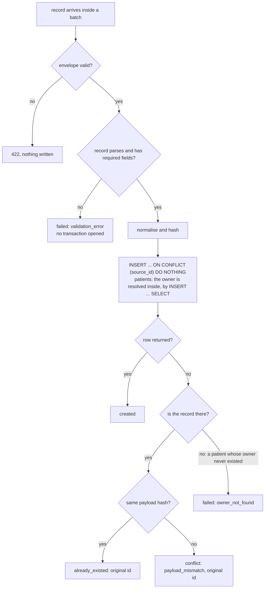
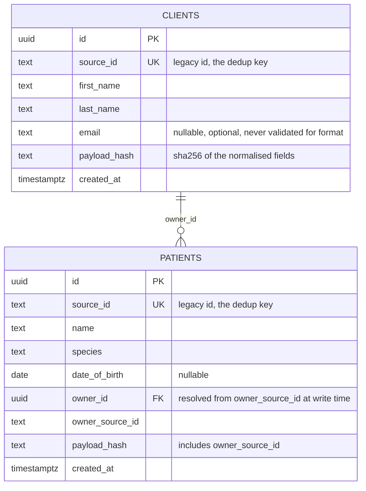
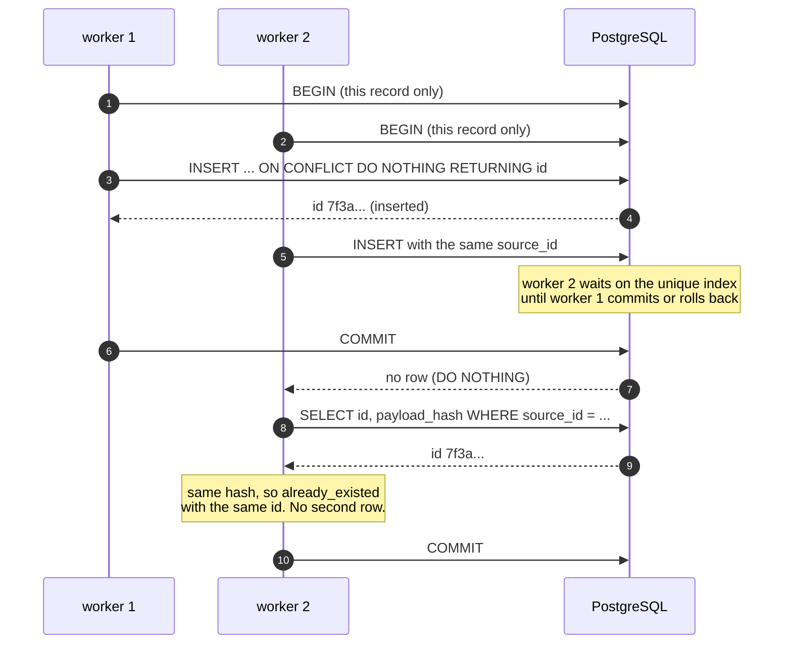

# Idempotent bulk import

A small HTTP service that receives clinic data in batches from a migration tool: clients (pet
owners) and patients (their animals). It is **always safe to retry** — sending the same records
again, one after another or from ten workers at the same time, never creates a duplicate and
always answers with the same ids.

Python 3.12, FastAPI, psycopg 3 with raw SQL, PostgreSQL 16, pytest. Everything runs in Docker;
the prerequisite is **Docker with the Compose plugin**, plus `curl` for `scripts/demo.sh` and
`scripts/bench.sh`.

The design is deliberately short: one transaction per record, the idempotency guarantee in a
database constraint, and every decision written down with the alternative it rejected.

**Quick path:** `docker compose up --build` starts it on <http://localhost:8000>; `docker compose
run --rm tests` runs 38 tests in about two seconds. Everything below is reproducible from a clean
clone.

## Contents

**Start here** — [Run and test](#run-and-test) · [What was asked, and where it is](#what-was-asked-and-where-it-is) · [Repository map](#repository-map) · [Configuration](#configuration)

**The contract** — [One record, end to end](#one-record-end-to-end) · [Schema](#schema) · [API](#api)

**The demo** — [See it work](#see-it-work) · [Look at the data](#look-at-the-data)

**Why it is correct** — [How it is correct](#how-it-is-correct) · [Tests, and what each proves](#tests-and-what-each-proves) · [Where this sits in an ETL pipeline](#where-this-sits-in-an-etl-pipeline)

**Context** — [How fast is it](#how-fast-is-it) · [Considered and rejected](#considered-and-rejected) · [Not built, deliberately](#not-built-deliberately) · [How I used AI](#how-i-used-ai) · [What I would do next](#what-i-would-do-next-and-what-i-cut) · [Time and scope](#time-and-scope)

## What was asked, and where it is

| Requirement | Where it lives |
|---|---|
| One request carries many records; the answer says per record whether it was created, already existed or failed, and why | [API](#api), [See it work](#see-it-work) |
| A patient points at its owner; a missing owner fails that record only | [See it work](#see-it-work) |
| Retrying is always safe, sequentially or concurrently, with the same ids | [ADR 0001](docs/adr/0001-dedup-on-source-id.md), [`tests/concurrency/`](tests/concurrency) |
| A record resent with different data: decide and justify | [ADR 0002](docs/adr/0002-conflict-policy.md), [See it work](#see-it-work) |
| Tests that prove it, including concurrent duplicates | [Tests, and what each proves](#tests-and-what-each-proves) |
| The notification that happens after the write commits (written answer, no code) | [`docs/written-answer.md`](docs/written-answer.md) |
| One command to start it, one to run the tests | [Run and test](#run-and-test) |
| How AI was used and what had to be corrected | [`docs/ai-usage.md`](docs/ai-usage.md) |
| What I would do next, and what I cut | [What I would do next](#what-i-would-do-next-and-what-i-cut) |
| Owners arriving late, throttling, multi-day progress reporting (one line each, not built) | [Not built, deliberately](#not-built-deliberately) |

## Run and test

```bash
docker compose up --build    # then: curl localhost:8000/health  ->  {"status":"ok"}
docker compose run --rm tests
```

The service is on <http://localhost:8000>, with interactive docs at `/docs`. The schema is applied at
startup under an advisory lock, so several instances can boot at once without racing on the catalog.

38 tests, about two seconds. For a subset, prefix the same command:
`docker compose run --rm tests pytest tests/api` (or `tests/concurrency`, or `-k conflict`). They use a **separate database** on the same server, created by the test session and
truncated between tests, so `docker compose up` data is never touched. The database log shows one
`duplicate key` ERROR per run on purpose — it is the test that asserts the constraint — and the one
warning comes from inside Starlette's `TestClient`, not from this code.

The concurrency tests start a real uvicorn server and fire from real threads over sockets:
`TestClient` runs the app in-process, so it cannot show two writers racing on the same rows.

If port 8000 is taken, remap it in `compose.yaml` and export
`READY_URL=http://localhost:8080/health` for `scripts/demo.sh`. The database port is never published.

## Configuration

Nothing to configure for the documented commands: `compose.yaml` sets all three variables, and
`LOG_LEVEL` is also the code default.

| Variable | Used by | Value in Compose |
|---|---|---|
| `DATABASE_URL` | the service | `postgresql://postgres:postgres@db:5432/bulk_import` |
| `TEST_DATABASE_URL` | pytest | `postgresql://postgres:postgres@db:5432/bulk_import_test` |
| `LOG_LEVEL` | the service | `INFO` |

[Look at the data](#look-at-the-data) shows how to query the database without a published port.

## Repository map

```
src/bulk_import/
  main.py           routes, the connection pool, the response shape (thin on purpose)
  schemas.py        Pydantic: the envelope is validated whole, records one by one
  normalize.py      the single place where "same data" is defined, plus the payload hash
  import_service.py the use case: one short transaction per record
  db.py             pool sizing, schema loading, no ORM
  schema.sql        clients, patients, and the UNIQUE constraints everything rests on
examples/           example payloads, each one posted and asserted by a test
scripts/
  demo.sh           a scripted migration: five requests and the report for each
  report.py         prints one response as a report; standard library only
tests/
  unit/             normalisation and hashing, no database
  api/              the HTTP contract: statuses, conflicts, 422 vs failed, 503 on an outage
  concurrency/      real server, real threads, plus the negative control
  test_schema.py    the constraints and the index the design depends on
  test_schema_startup.py  three instances applying the schema at the same time
  test_logging.py   what the operator sees
  test_health.py    the service boots
  conftest.py       test database, per-test cleanup, the live server fixture
docs/
  adr/              the four decisions that carry the design, one page each
  written-answer.md the post-commit notification question
  ai-usage.md       how AI was used and what it got wrong
compose.yaml        db (healthcheck) + app + a `tests` service behind a profile
Dockerfile          one image for the service and the tests, Python 3.12 slim
pyproject.toml      ruff and pytest configuration
```

---

## One record, end to end



One short transaction per record, so `created`, `already_existed`, `conflict` and `failed` are
decided independently for every row in the batch.

## Schema



`UK` on `source_id` in both tables is the whole idempotency guarantee; `payload_hash` is what
separates an identical retry from a changed record. `patients (owner_id)` carries its own index:
PostgreSQL indexes the parent side of a foreign key, never the child, and both deleting a client and
counting patients per owner read that column.

## API

Two endpoints with the same behaviour: `POST /clients/bulk` and `POST /patients/bulk` take up
to 1000 records, answer `200` with one result per record **in request order**, and never fail
the batch because of one bad record. Ids are UUIDs generated by the database.

```json
{"records": [{"source_id": "C-1", "first_name": "Ana", "last_name": "Ruiz", "email": "ana@example.com"}]}
{"records": [{"source_id": "P-1", "name": "Luna", "species": "dog",
              "date_of_birth": "2020-01-02", "owner_source_id": "C-1"}]}
```

| `status` | `id` | `error.code` | Meaning |
|---|---|---|---|
| `created` | new uuid | `null` | written by this request |
| `already_existed` | original uuid | `null` | same data, nothing written |
| `conflict` | original uuid | `payload_mismatch` | same `source_id`, different data, nothing overwritten |
| `failed` | `null` | `validation_error`, `owner_not_found`, `database_error` | rejected, nothing written |

`/docs` renders this contract from the type annotations, including the per-record schema and a
real example payload. The record type appears as a choice between a loose object and the typed
shape, and that looseness is deliberate: the envelope must accept a record it cannot parse so
that the bad one becomes a `failed` instead of rejecting the batch.

Validation is minimal and deliberate: required fields present and non-empty after normalisation,
bounded length, `date_of_birth` parseable as `YYYY-MM-DD`, `owner_source_id` resolvable. Email
format is **not** validated — the field is optional, and failing a real client over an address
this service cannot verify would block a migration for no gain.

`422` is reserved for a malformed **envelope**: `records` missing, not a list, empty, longer than
1000, or containing something that is not an object at all (`null`, `"C-1"`, `42`). A bad *field*
inside a record is a per-record `failed`, so one broken row never rejects the other 999; an element
that is not an object cannot be reported per record, and that is the one boundary where the batch is
rejected.

---

## See it work

Everything below runs against a fresh `docker compose up`; ids are random per run.

**1. Create two clients** — one request, many records, one result each.

```bash
curl -s -X POST localhost:8000/clients/bulk -H 'content-type: application/json' -d '{
  "records": [
    {"source_id": "C-1", "first_name": "Ana", "last_name": "Ruiz", "email": "ana@example.com"},
    {"source_id": "C-2", "first_name": "Luis", "last_name": "Paz"}
  ]
}'
```

```json
{"summary": {"created": 2, "already_existed": 0, "conflict": 0, "failed": 0},
 "results": [
   {"index": 0, "source_id": "C-1", "status": "created", "id": "41502587...", "error": null},
   {"index": 1, "source_id": "C-2", "status": "created", "id": "6f670e1f...", "error": null}]}
```

**2. Patients, one with a missing owner.** `P-2` fails alone, `P-1` is written, and `species` sent as
`Dog` is stored as `dog`.

```bash
curl -s -X POST localhost:8000/patients/bulk -H 'content-type: application/json' -d '{
  "records": [
    {"source_id": "P-1", "name": "Luna", "species": "Dog",
     "date_of_birth": "2020-01-02", "owner_source_id": "C-1"},
    {"source_id": "P-2", "name": "Michi", "species": "cat", "owner_source_id": "C-404"}
  ]
}'
```

```json
{"summary": {"created": 1, "already_existed": 0, "conflict": 0, "failed": 1},
 "results": [
   {"index": 0, "source_id": "P-1", "status": "created", "id": "17c13ab7...", "error": null},
   {"index": 1, "source_id": "P-2", "status": "failed", "id": null,
    "error": {"code": "owner_not_found",
              "message": "owner_source_id C-404 does not exist"}}]}
```

**3. The same batch again, a changed record, and a cosmetic change** — all of them files, each one
asserted by [`tests/api/test_examples.py`](tests/api/test_examples.py):

| File | What it demonstrates |
|---|---|
| [`clients-batch.json`](examples/clients-batch.json) | the full load: two new clients |
| [`clients-cosmetic-retry.json`](examples/clients-cosmetic-retry.json) | the same two with whitespace and email case changed: `already_existed`, same ids |
| [`clients-changed.json`](examples/clients-changed.json) | one changed surname: `conflict`, nothing overwritten |
| [`clients-mixed.json`](examples/clients-mixed.json) | one valid, one invalid, one duplicate `source_id` in the same request |
| [`patients-batch.json`](examples/patients-batch.json) | one patient whose owner exists, one whose owner does not |

```bash
docker compose up -d && ./scripts/demo.sh
```

<details>
<summary>What the script prints for one of the five requests</summary>

```
200  POST /clients/bulk   <- examples/clients-mixed.json
    3 records in the batch
    created           1  █
    already_existed   1  ·
    conflict          0
    failed            1  x

    #0  C-9    created          id=54b3a7cb
    #1  C-10   failed           id=-         validation_error
    #2  C-9    already_existed  id=54b3a7cb
```

That is verbatim for this request; the other four print the same shape and the script ends with the
row counts. `down -v` removes the volume, which is how to replay the demo from scratch.

</details>

**4. The two cases no file covers.** An empty envelope is a `422`; a NUL byte is a per-record
`validation_error` with the batch answering `200`. (A broken record beside a valid one is
`clients-mixed.json` in the table above.)

```json
{"detail": [{"type": "too_short", "loc": ["body", "records"],
             "msg": "List should have at least 1 item after validation, not 0"}]}
```

The cosmetic retry in the table — `"  Ana "` answering `already_existed` — is the decision most
worth arguing about, so it has a full page: [ADR 0002](docs/adr/0002-conflict-policy.md).

## Look at the data

The database port is not published, so query it inside the container:

```bash
docker compose exec db psql -U postgres -d bulk_import -c \
  "select source_id, first_name, email, left(payload_hash, 12) as hash from clients
   where source_id in ('C-1', 'C-2') order by source_id"
```

```
 source_id | first_name |      email      |     hash
-----------+------------+-----------------+--------------
 C-1       | Ana        | ana@example.com | 3590e3be1b81
 C-2       | Luis       |                 | a6c4bf19e452
```

`C-1` is still `Ana` after the conflict attempt, and its hash has not moved: the stored values are
the first version and the hash is what an incoming record is compared against. `\d clients` shows
the `UNIQUE (source_id)` constraint; `scripts/demo.sh` ends with the row counts; and
[`tests/test_schema.py`](tests/test_schema.py) pins the constraints and the `owner_id` index.

## How it is correct

Seven decisions. Four have a page of their own in [`docs/adr`](docs/adr); the rest are here
because they have no ADR.

1. **Deduplicate on the business key, enforced by the database**
   ([ADR 0001](docs/adr/0001-dedup-on-source-id.md)): `UNIQUE (source_id)` +
   `INSERT ... ON CONFLICT DO NOTHING RETURNING id`. Checking before inserting is a race; a
   constraint is not — and
   [`test_check_then_insert_is_a_race.py`](tests/concurrency/test_check_then_insert_is_a_race.py)
   runs the naive version and produces the duplicate.
2. **`ON CONFLICT DO NOTHING` returns no row**, so a second `SELECT` fetches the committed row. It
   runs in `READ COMMITTED`, where every statement sees the latest committed data; under
   `REPEATABLE READ` that read would miss the row the other worker just committed.
3. **Resent with different data is a `conflict`, never an overwrite**
   ([ADR 0002](docs/adr/0002-conflict-policy.md)). In a migration, a visible error beats a silent
   change.
4. **Normalisation defines "same data", once, on ingress**
   ([`normalize.py`](src/bulk_import/normalize.py)): what is stored is what is compared.
5. **One short transaction per record**
   ([ADR 0003](docs/adr/0003-per-record-transaction.md)): per-record outcomes, no batch rollback,
   and two workers in a different order cannot deadlock.
6. **Validation runs before the database is touched**, so `validation_error` always wins over
   `owner_not_found` and an invalid record never opens a transaction.
7. **An error belongs either to the record or to the connection**
   ([ADR 0004](docs/adr/0004-error-ownership.md)). `DataError` and `IntegrityError` fail that
   record; `OperationalError`, `InterfaceError` and a pool timeout answer `503` with no per-record
   results, because claiming a record failed when the database was down is a lie. A non-whitespace
   control character (`NUL`, `0x01`…) is rejected, never stripped; whitespace is collapsed by
   normalisation, which is a different rule and documented in ADR 0002.

### Why two workers cannot duplicate a record



The waiting is done by the unique index, not by application code: that is why a
check-then-insert cannot be fixed with a lock in the handler, and why the negative control in
[`tests/concurrency/`](tests/concurrency) produces a duplicate when the constraint is missing.

## Tests, and what each proves

| File | What it establishes |
|---|---|
| [`tests/unit/test_normalize.py`](tests/unit/test_normalize.py) | Key order cannot change a hash; absent, `null` and `""` are the same data; whitespace and email case collapse; a real change gives a different hash; `source_id` keeps its case because it is the identity |
| [`tests/api/test_clients_bulk.py`](tests/api/test_clients_bulk.py) | Per-record results in request order; a retry returns the same ids with no new rows; a changed record is a conflict and the row is untouched; a cosmetic change is not a conflict; duplicates inside one request; a broken record does not affect its neighbours; envelope errors are 422; the `UNIQUE` constraint rejects a second row |
| [`tests/api/test_patients_bulk.py`](tests/api/test_patients_bulk.py) | Owner resolution and the stored link; a missing owner fails alone; patient retries and conflicts; invalid records open no transaction; validation wins over a missing owner |
| [`tests/concurrency/test_concurrent_duplicates.py`](tests/concurrency/test_concurrent_duplicates.py) | Ten workers, same batch: exactly one `created` per record, identical ids everywhere, one row each, five rounds. Overlapping batches in reverse order: no duplicates, no deadlock. Concurrent patients with the same `source_id` |
| [`tests/concurrency/test_check_then_insert_is_a_race.py`](tests/concurrency/test_check_then_insert_is_a_race.py) | The negative control: without the constraint, check-then-insert really does create the duplicate. This is what makes the other concurrency test evidence instead of hope |
| [`tests/api/test_examples.py`](tests/api/test_examples.py) | Posts every file in [`examples/`](examples) in order and asserts the documented outcome, so the examples cannot rot |
| [`tests/test_logging.py`](tests/test_logging.py) | The operator gets a batch summary and one line per rejected record with the reason — the response is for the caller, the log is for the operator |
| [`tests/test_schema.py`](tests/test_schema.py) | `source_id` is unique on both tables, and `patients (owner_id)` is indexed |
| [`tests/test_schema_startup.py`](tests/test_schema_startup.py) | Three instances applying the schema at the same time: no catalog race |
| [`tests/api/test_database_outage.py`](tests/api/test_database_outage.py) | A connection failure is a `503` with no per-record results, not a thousand fake record failures |
| [`tests/test_health.py`](tests/test_health.py) | The service boots |

Tests assert what they are able to assert: the client tests check the response and the table,
`test_validation_wins_over_a_missing_owner` checks the response only, the unit tests have no database, the logging
test asserts log records, and the negative control checks both workers' return values and the row
count.

## Where this sits in an ETL pipeline

A migration is extract, transform, load, and this service is deliberately only the **load** step —
the one where correctness is decided. Extraction and the field mapping per source system belong to
the migration tool. The one slice of transform here is canonicalisation
([`normalize.py`](src/bulk_import/normalize.py)), because "the same data" must be defined where the
duplicate is compared.

Automated: rerunning any batch unattended, the cosmetic cleanup, the per-record outcome, and the
regression suite. Left as judgement: what a `conflict` means — a real change goes through the update
path, a data error goes back to the clinic — and the mapping per source system, which is exactly
where the next migration gets cheaper. Automate the repeatable, keep the judgement visible.

## How fast is it

Reproduce it with `./scripts/bench.sh`, which posts a 1000-record batch twice and times both.
Measured on one laptop with the stack in this repository: a 1000-record batch takes **about 1.3 s**
(~800 records/s) the first time, and **0.13 s** (~8,000) sent again — the retry writes nothing, so it
costs a tenth. At that rate 200,000 records is about four minutes of endpoint time, 25 seconds for a
replay.

Numbers move with hardware and `fsync` settings; the shape is the point, and the shape is what
justifies one transaction per record. A real migration's wall clock is dominated by extraction,
validation and cutover, not by this service.

## Considered and rejected

The alternatives a reviewer usually asks about, and why they lost:

- **`ON CONFLICT DO UPDATE SET source_id = EXCLUDED.source_id RETURNING ...`** returns the
  existing row in one round trip instead of two. Rejected because it turns every duplicate into
  a write: WAL, row locks and triggers for a row nobody is changing. It also needs a `WHERE`
  guard to avoid rewriting, and it hides "we never modify an existing record" behind a no-op
  update. The extra `SELECT` reads instead of writing, and the constraint keeps saying what it
  means.

Two alternatives have a page of their own: a request-level `Idempotency-Key` in
[ADR 0001](docs/adr/0001-dedup-on-source-id.md) and one transaction per batch in
[ADR 0003](docs/adr/0003-per-record-transaction.md). The rest:

- **SQLite**: it supports the same `INSERT ... ON CONFLICT DO NOTHING RETURNING`, and it also
  returns no row for the conflicted insert, so the write path would carry over. Rejected because
  it has a single writer: a concurrent test would prove very little, and the row-level locking
  that this design relies on cannot be exercised. Postgres gives the concurrency tests something
  real to race on.
- **An ORM (Django or SQLAlchemy)**: would hide the constraint and the `ON CONFLICT` clause —
  exactly the two lines this design has to be judged on.
- **Async handlers**: the concurrency that matters here lives in the database, not in the event
  loop. Sync handlers plus a connection pool keep the connection story trivial — one checkout per
  record, never a shared connection between threads — and are easier to explain.
- **Hexagonal layers, ports and repository classes**: for a two-hour exercise they add surfaces
  to explain without adding a guarantee. The dependency direction is still one-way:
  routes → use case → normalisation/schema, with the database behind a function call. In Provet
  this would be a Django app, and the core (`UNIQUE` + `ON CONFLICT` + per-record transaction)
  would carry over unchanged.

## Not built, deliberately

The brief asked for a line or two on each:

- **Owners arriving after their patients, or in the same request.** Park the patient in a
  `pending_owner` table keyed by `owner_source_id` and resolve it when the owner arrives; only the
  record's disposition changes, from `failed` to `pending`.
- **Throttling the migration tool.** Answer `429` with `Retry-After` when the pool is saturated and
  keep a bounded queue. Today it already answers `503`, so the tool retries; what is missing is the
  advice on *when*.
- **Reporting progress across a run that takes days.** A `runs` table with a row per run and the
  per-record outcomes, plus `GET /runs/{id}`. The per-record results already carry that data.

Known limits, stated rather than hidden: no authentication, single tenant (`UNIQUE (source_id)`
would become `UNIQUE (tenant_id, source_id)`), no read or update endpoints, the pool is a constant.

Logging goes to stdout as plain text: one `INFO` per batch and one `WARNING` per rejected or
conflicting record, with its `source_id` and code. That is what an operator needs to answer "where
did those 300 patients go?" a week later; it is not structured JSON and it is not aggregated, which
is the first thing to fix when this runs for real.

## How I used AI

Briefly: I used an AI assistant as a pair — design discussion before writing, the test suite
first, and this documentation. Every decision in this README is one I can defend, and the
assistant's mistakes are listed in [`docs/ai-usage.md`](docs/ai-usage.md) with how each was
caught. The two worth naming: it typed `date_of_birth` as `Any` (which would accept garbage
dates instead of failing the record), caught by reading the diff; and its first test fixture
committed the `TRUNCATE` only at teardown, which holds an exclusive lock and would have blocked the
service's own inserts, caught by running the suite. The pattern in this exercise: the assistant
was fast at volume and wrong at the boundaries, and the boundaries are exactly what the tests
are for.

## What I would do next, and what I cut

What I would do next, in order:

1. **Versioned updates for delta runs.** A real delta changes data. Today a changed record is a
   visible `conflict`; the production answer is an update applied only when the legacy
   `source_updated_at` is newer than what we stored, so replay order stops mattering.
2. **Transactional outbox.** The event commits with the row; the relay and the idempotent consumer
   are in [`docs/written-answer.md`](docs/written-answer.md). The one stretch item I did not build.
3. **Alembic instead of `schema.sql` at startup**, and a pool size read from configuration.
4. **A `conflict` that names the fields that changed.** The columns are already stored, so it is a
   comparison, not a schema change — and for the migration team it is worth much more than an
   opaque `payload_mismatch`.

Cut on purpose: everything in [Not built](#not-built-deliberately), plus CI, metrics, and a
normalisation policy agreed with the migration team.

## Time and scope

I treated this as a two-hour exercise and stopped at the timebox: what I would do next is
[here](#what-i-would-do-next-and-what-i-cut), and what I deliberately did not build is
[here](#not-built-deliberately).

The design came first — deduplicating on the business key, a conflict instead of an overwrite, one
transaction per record — and the ADRs are where those decisions live. ADR 0004 is the exception: it
records a decision the review provoked, not one I had before writing code.

`v1.0.0` is what I delivered. Every commit after it comes from review feedback, and
`git log v1.0.0..main` is that conversation: the record schema in `/docs`, structured logging, the
README restructure, and the fixes the findings produced — error ownership, the patient
settle-before-resolve order, the owner index, the schema lock and a deterministic negative control.
